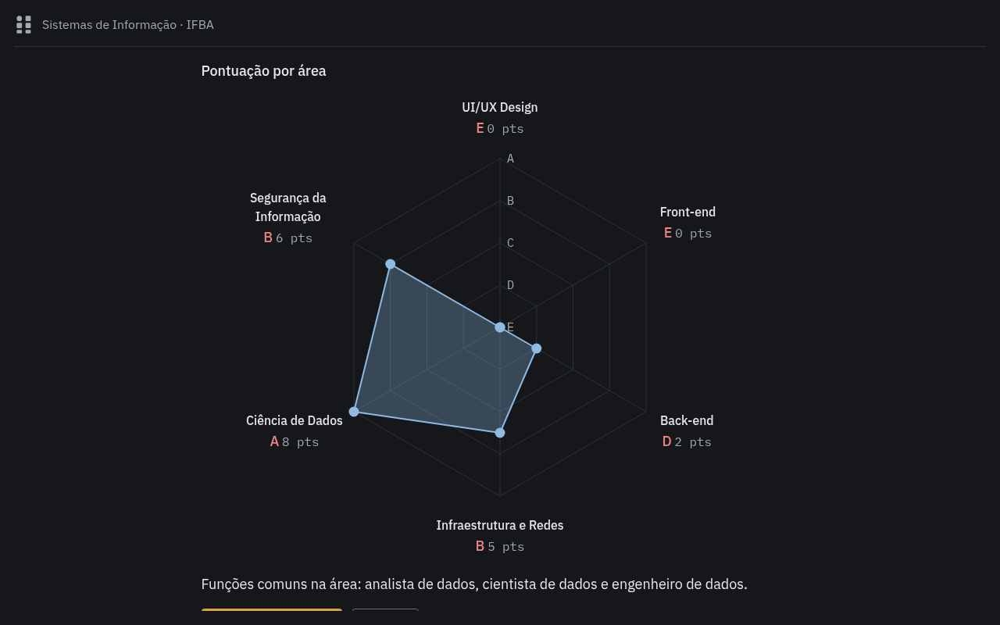
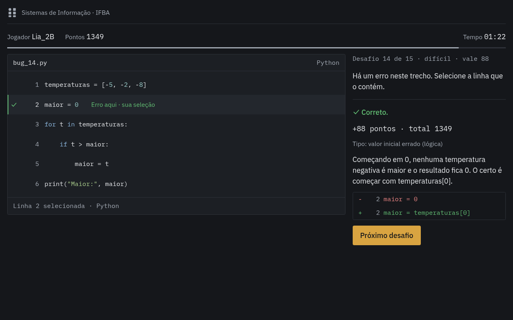

# Stand de Sistemas de Informação | IFBA

Dois jogos para tablets Android, feitos para o stand do curso e voltados a estudantes do ensino médio (15 a 18 anos):

| Jogo | O que faz | Duração |
|---|---|---|
| [Quiz de perfil profissional](quiz-perfil-profissional/README.md) | 7 perguntas do dia a dia revelam a área da tecnologia que mais combina com a pessoa: UI/UX, Front-end, Back-end, Infraestrutura e Redes, Dados ou Segurança da Informação. O resultado traz um gráfico de radar com o nível (A a E) de cada área. | até 2 min |
| [Corrida contra o Bug](corrida-contra-o-bug/README.md) | Trechos curtos de Python com um erro cada: quem acha a linha errada mais rápido faz mais pontos. São 36 trechos; cada partida sorteia 15, do fácil ao difícil. Tem ranking Top 10 e área do administrador. | 90 s |

Os dois funcionam **100% offline** (sem CDN; as fontes IBM Plex vão embutidas), usam só HTML, CSS e JavaScript puro, e viram APK com o [Capacitor](https://capacitorjs.com).

O sistema visual (tokens de cor, tipografia, espaçamento, regras e proibições) está em [DESIGN.md](DESIGN.md), fonte única para os dois jogos.





Mais capturas, em tablet e celular, em [docs/capturas](docs/capturas/README.md).

## Baixar os APKs

Os APKs prontos ficam em [Releases](https://github.com/caio2203/stand-sistemas-de-informacao/releases). Os links abaixo sempre apontam para a versão mais recente:

| Jogo | APK |
|---|---|
| Quiz de perfil profissional | [quiz-perfil-profissional.apk](https://github.com/caio2203/stand-sistemas-de-informacao/releases/latest/download/quiz-perfil-profissional.apk) |
| Corrida contra o Bug | [corrida-contra-o-bug.apk](https://github.com/caio2203/stand-sistemas-de-informacao/releases/latest/download/corrida-contra-o-bug.apk) |

Copie o APK para o tablet e abra o arquivo (permita "instalar apps desconhecidos"), ou use `adb install -r arquivo.apk`. São APKs de debug, suficientes para o stand.

> Antes de atualizar o Corrida contra o Bug, exporte o ranking pela área do administrador. Se o Android recusar a atualização (assinatura diferente), será preciso desinstalar a versão antiga, e isso apaga o ranking.

**Publicar uma versão nova:** gere os dois APKs (veja o README de cada jogo), crie uma release com a tag `vX.Y.Z` e anexe os arquivos com os mesmos nomes da tabela, para os links continuarem funcionando.

## Estrutura

```
stand-sistemas-de-informacao/
  README.md                     este arquivo
  DESIGN.md                     sistema visual dos dois jogos (tokens, regras, decisões)
  compartilhado/                núcleo comum aos dois jogos (FONTE ÚNICA: edite aqui)
    tokens.css                  tokens de design: cor, tipografia, espaço (ver DESIGN.md)
    fontes.css, fontes/         IBM Plex Sans e Mono embutidas (licença OFL)
    base.css                    reset, áreas seguras, troca de telas, componentes comuns
    icones.js                   check e x (únicos ícones)
    formato.js                  formatação de tempo mm:ss
    navegador.js                alterna as telas e avisa entrar()/sair()
    inatividade.js              volta ao início após X segundos sem toque
    plataforma.js               Capacitor x navegador, tela cheia, barras do sistema
    dom.js                      utilitários de DOM (referências, animações, agendador)
    sintetizador.js             sons gerados por código (Web Audio)
  scripts/
    sincronizar-compartilhado.mjs   copia compartilhado/ para www/ de cada jogo
  docs/
    capturas/                   prints dos dois jogos (tablet e celular)
  quiz-perfil-profissional/     projeto Capacitor do quiz
  corrida-contra-o-bug/         projeto Capacitor do Corrida contra o Bug
```

Em cada jogo, as pastas `android/` (criada pelo `npx cap add android`), `node_modules/` e `www/compartilhado/` são geradas e ficam fora do git. A única personalização nativa, o `MainActivity.java` com o modo imersivo, fica guardada em `android-personalizado/`.

## Arquitetura

Cada jogo é um aplicativo modular (ES Modules, sem etapa de build) dividido em camadas. As dependências apontam sempre "para dentro": a interface conhece o domínio, o domínio não conhece ninguém.

```
            main.js  (raiz de composição: cria tudo e liga as peças)
               |
     +---------+-------------------+
     |                             |
    ui/  (telas, DOM)         aplicacao/  (casos de uso, só no Bug)
     |                             |
     +-------------+---------------+
                   |
               dominio/  (regras puras, sem DOM nem armazenamento)  <-- testado com node --test
                   |
                dados/   (conteúdo editável: perguntas, áreas, trechos)

    infra/  (localStorage, arquivos, Capacitor)  implementa o que a aplicação precisa
    compartilhado/  (núcleo comum aos jogos)
```

Princípios usados:

- **Conteúdo separado do código.** Perguntas, áreas e trechos de Python ficam em `www/src/dados/`. Quem for editar textos não precisa tocar em lógica.
- **Regras puras e testadas.** Pontuação, resultado do quiz, tempo da partida, ranking, limpeza do apelido e destaque de sintaxe estão em `www/src/dominio/`, sem acesso a tela, relógio do sistema ou `localStorage`. Por isso têm testes automáticos (`npm test`).
- **Infraestrutura trocável.** O ranking é salvo por um repositório (`infra/repositorio-ranking.js`). Para levar o ranking a um servidor no futuro, basta outra classe com os mesmos métodos.
- **Telas com ciclo de vida.** Cada tela expõe `entrar()` e `sair()`. Ao trocar de tela, cronômetros e animações pendentes são cancelados: não há tarefa "fantasma" de uma partida abandonada.
- **Núcleo compartilhado sem duplicação manual.** O Capacitor empacota apenas a pasta `www/` de cada jogo, então `npm run preparar` copia `compartilhado/` para `www/compartilhado/`. A cópia é gerada e está no `.gitignore`; edite sempre a pasta da raiz.
- **Validação do conteúdo.** Ao abrir, cada jogo confere o conteúdo editável e avisa no console se algo estiver errado (área inexistente, linha do erro fora do trecho etc.). Os testes fazem a mesma checagem.

## Começo rápido

Requisitos: [Node.js](https://nodejs.org) 20 ou mais novo.

```bash
cd quiz-perfil-profissional
```

```bash
npm install
```

```bash
npm test
```

```bash
npm run servir
```

Depois abra `http://localhost:8080` (quiz) ou, na pasta do outro jogo, `http://localhost:8081` (Corrida contra o Bug).

> Os jogos usam ES Modules, que o navegador não carrega abrindo o `index.html` com dois cliques (`file://`). Use sempre um servidor local, como o `npm run servir`.

Para gerar o APK, veja o README de cada jogo, ou baixe os prontos em [Baixar os APKs](#baixar-os-apks).

## Dicas para o dia do evento

- **Fixar o app na tela:** no Android, ative *Configurações > Segurança > Fixar app* (o nome varia por fabricante). Assim ninguém sai do jogo pelo botão de início.
- **Tela sempre ligada:** o APK já impede o tablet de apagar a tela enquanto o jogo está aberto.
- **Não perturbe:** ative para que notificações não apareçam por cima do jogo.
- **Brilho alto e carregador por perto:** tela ligada o dia todo consome bateria.
- **Ranking:** exporte o CSV pela área do administrador ao fim de cada dia. Desinstalar o app ou limpar os dados dele apaga o ranking.
- **PIN do administrador:** troque o padrão (`2580`) em `corrida-contra-o-bug/www/src/config.js` antes do evento.
