# Capturas

Prints dos dois jogos em dois tamanhos: `1280` (1280 × 800, tablet em paisagem ou computador) e `375` (375 × 812, celular). O número no nome segue a ordem das telas na partida.

| Tela | Tablet | Celular |
|---|---|---|
| Quiz: início, com a escolha do tempo | 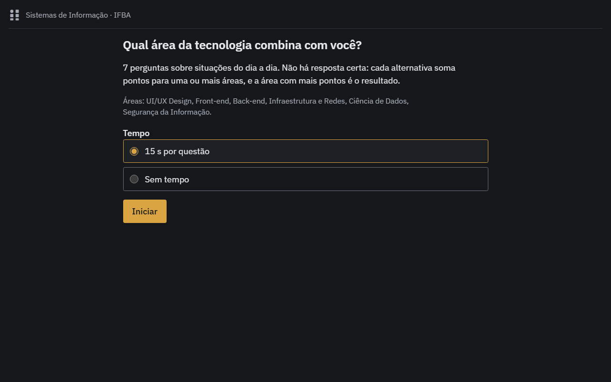 | 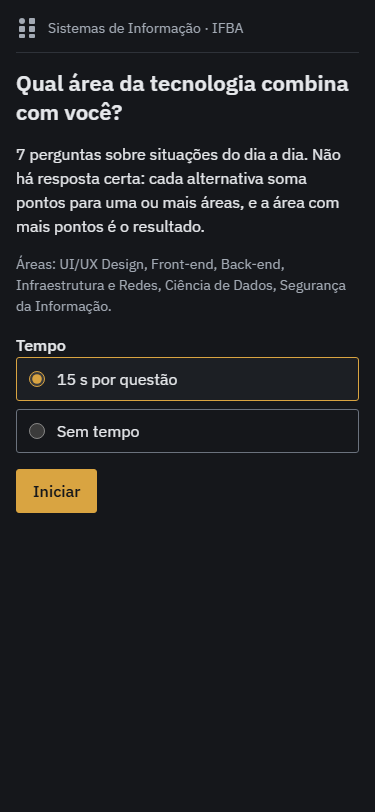 |
| Quiz: questão com alternativa selecionada | 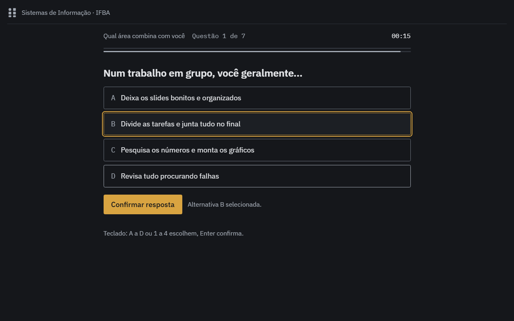 | 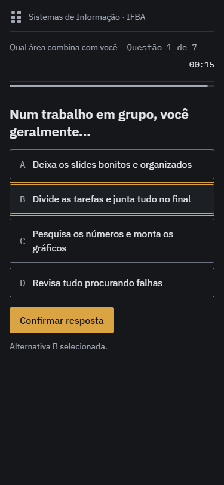 |
| Quiz: feedback com as áreas que somaram pontos | 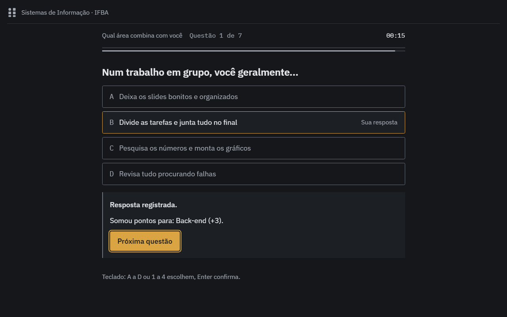 | 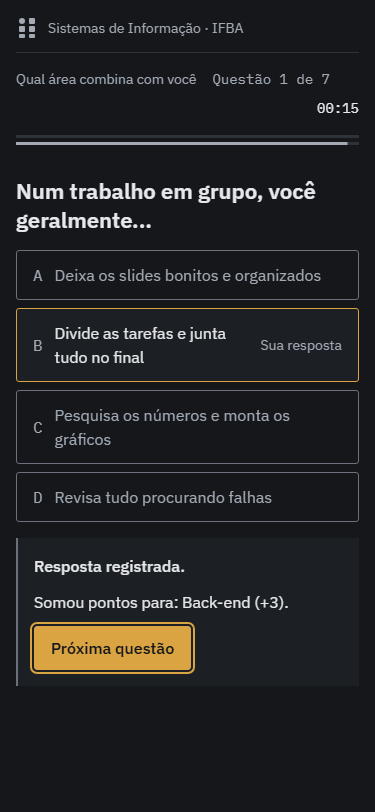 |
| Quiz: aviso nos últimos 5 s | 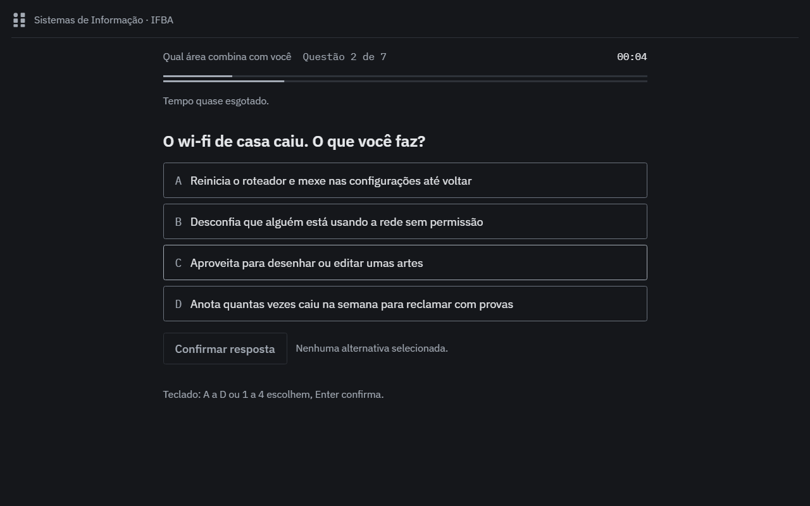 | 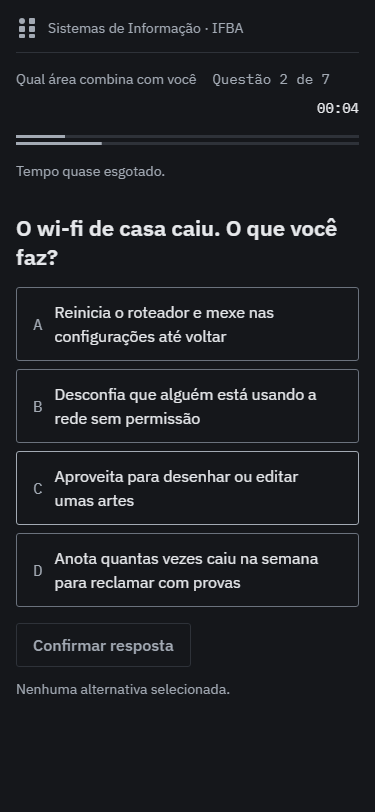 |
| Quiz: resultado com gráfico de radar |  | 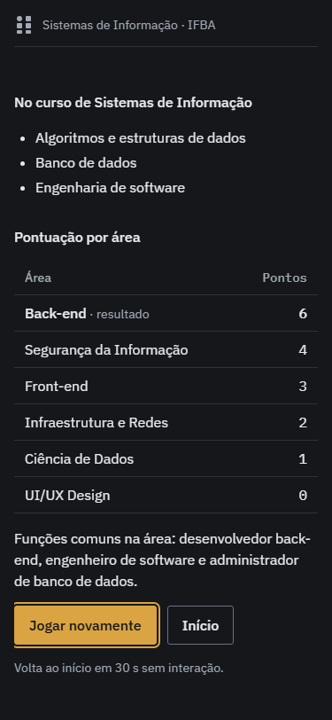 |
| Bug: início, com o apelido | 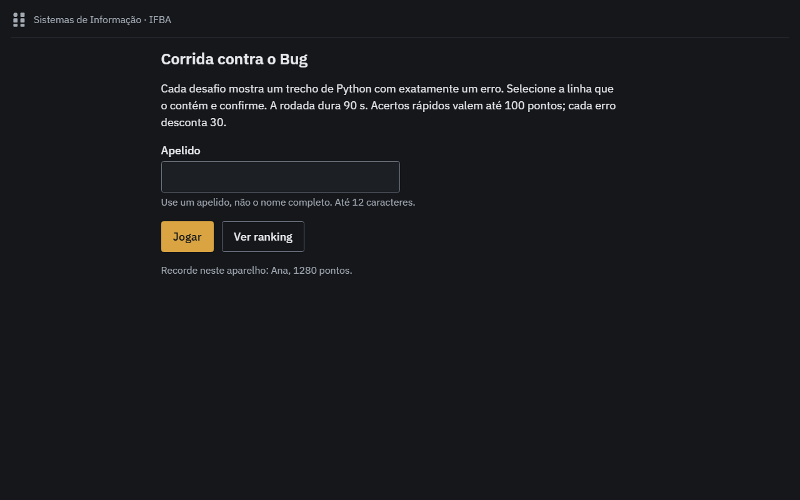 | 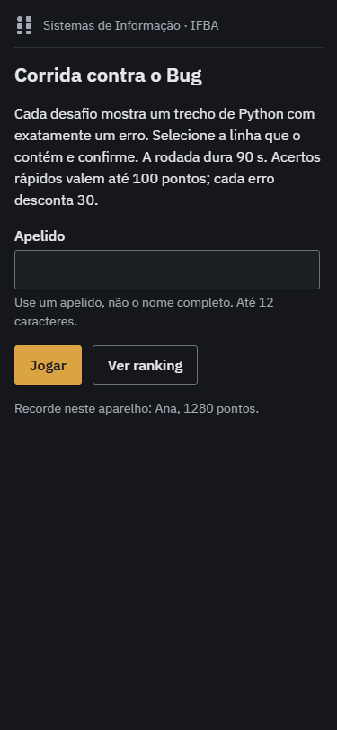 |
| Bug: desafio com uma linha selecionada | 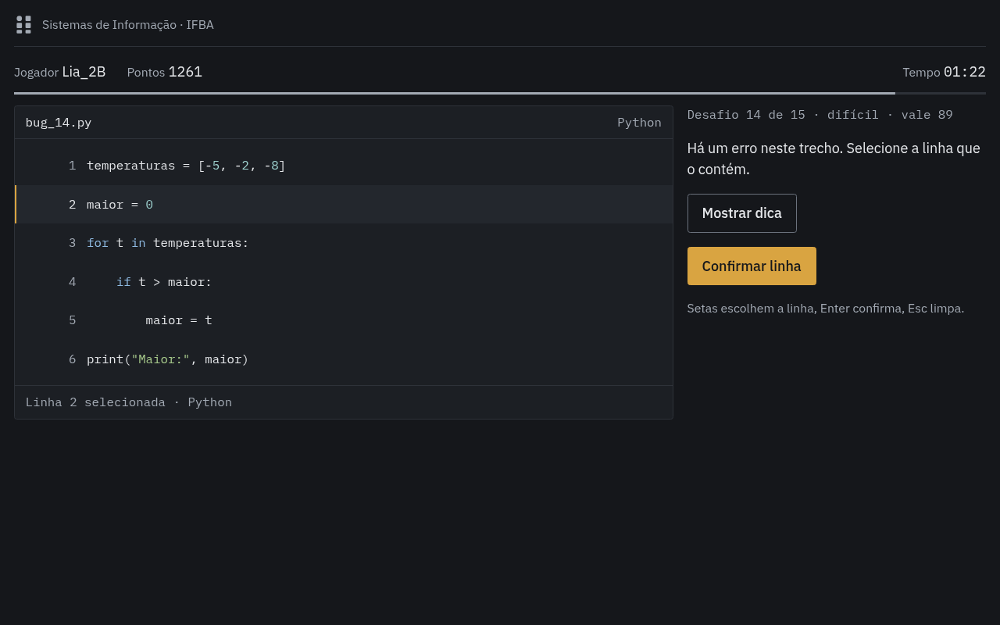 | 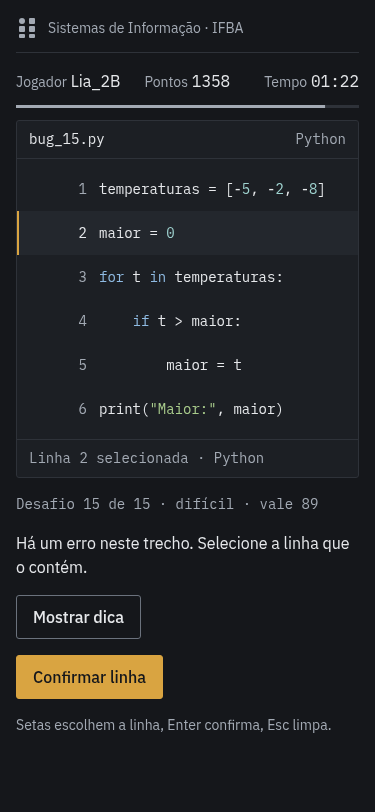 |
| Bug: feedback com tipo do erro e correção |  | 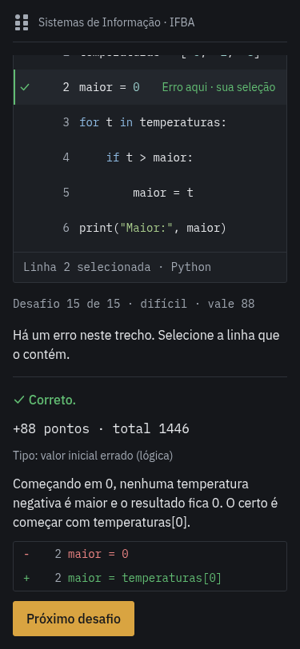 |
| Bug: fim da partida | 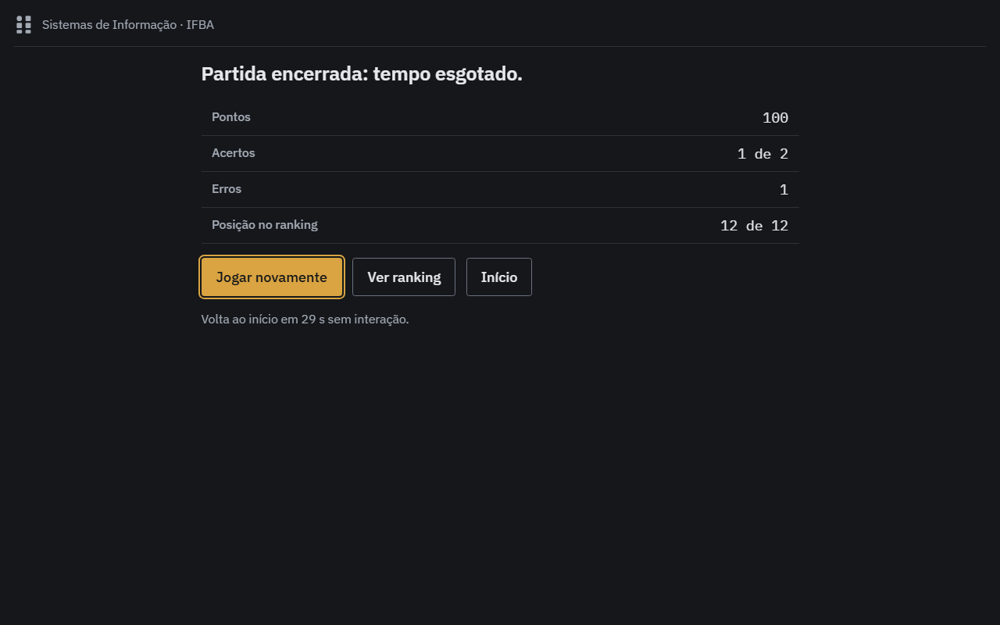 | 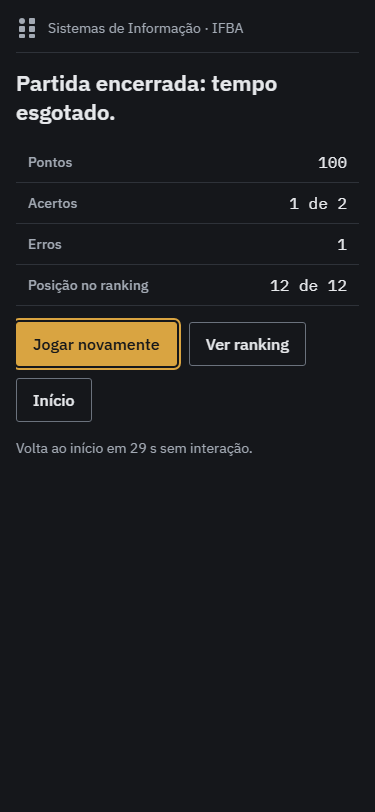 |
| Bug: ranking Top 10 | 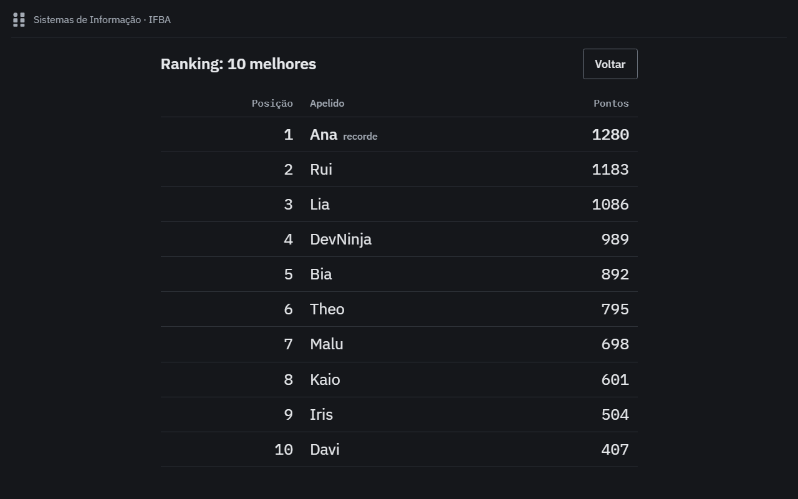 | 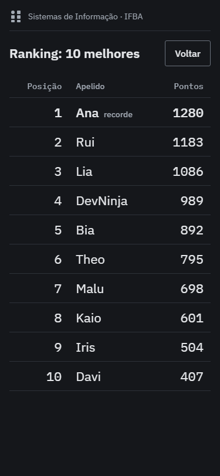 |
| Bug: painel do administrador | 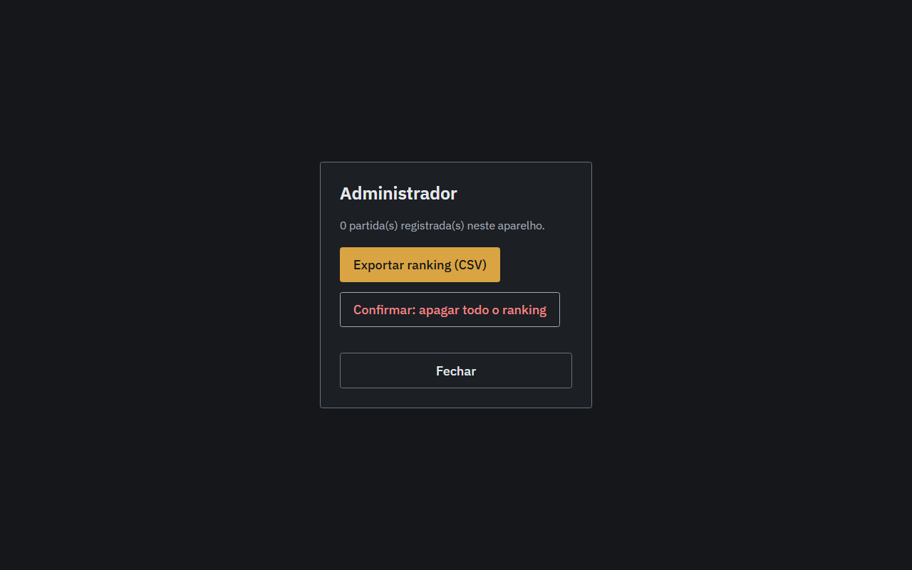 | 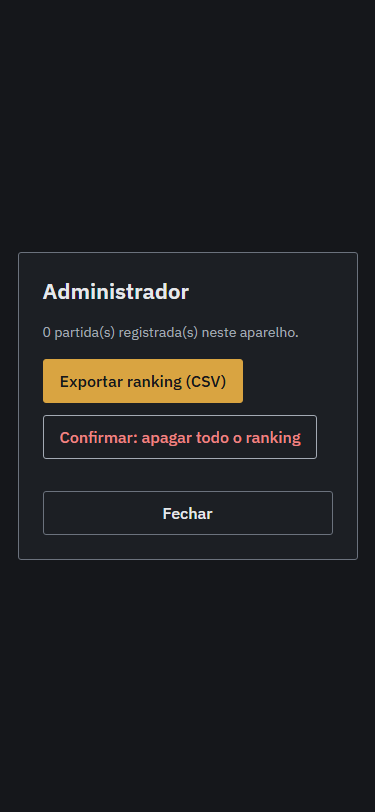 |

## Como atualizar

Rode o jogo com `npm run servir`, abra o modo de dispositivo do navegador (F12, ícone de celular) nos tamanhos acima e salve com o mesmo nome do arquivo antigo, para os links dos READMEs continuarem valendo. No tablet: botão liga/desliga + volume para baixo.
